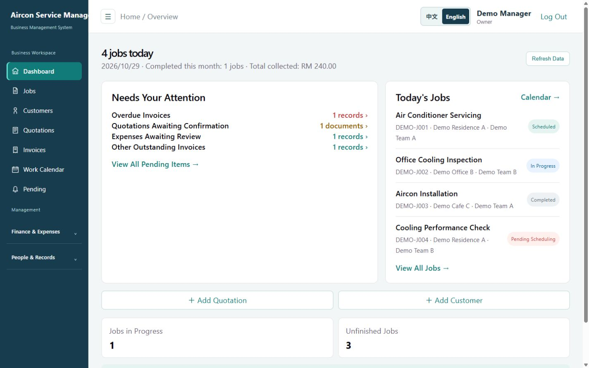
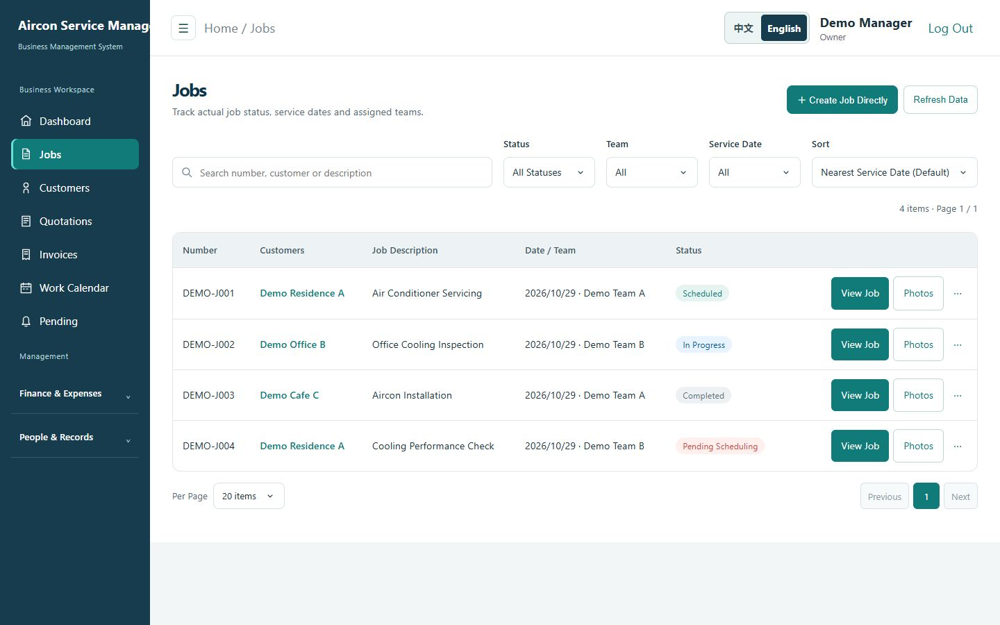
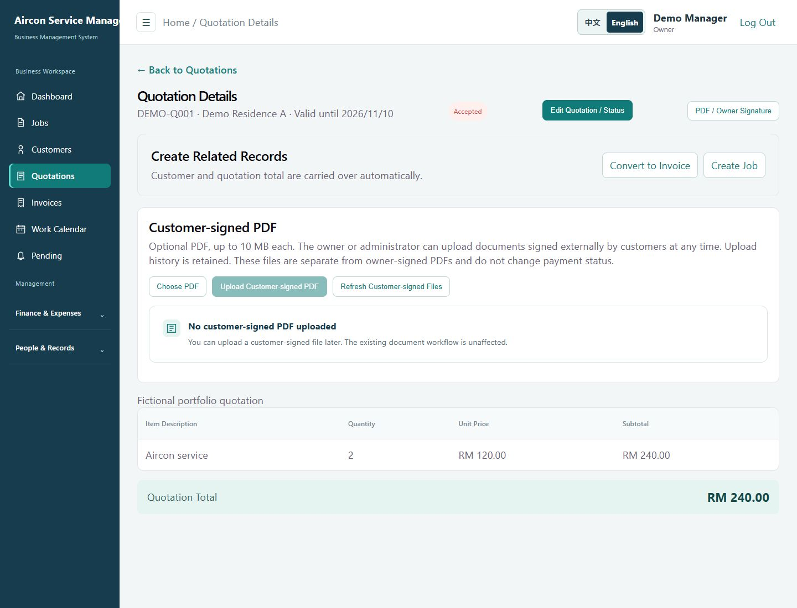
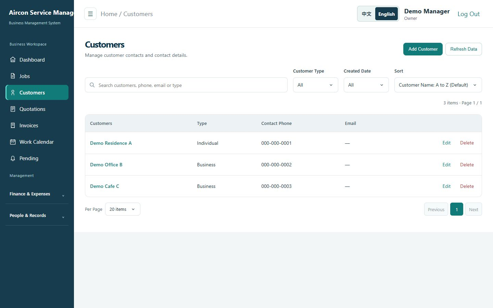
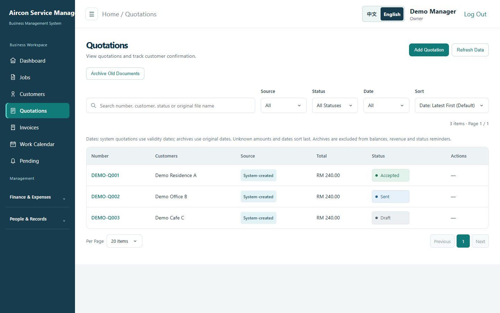
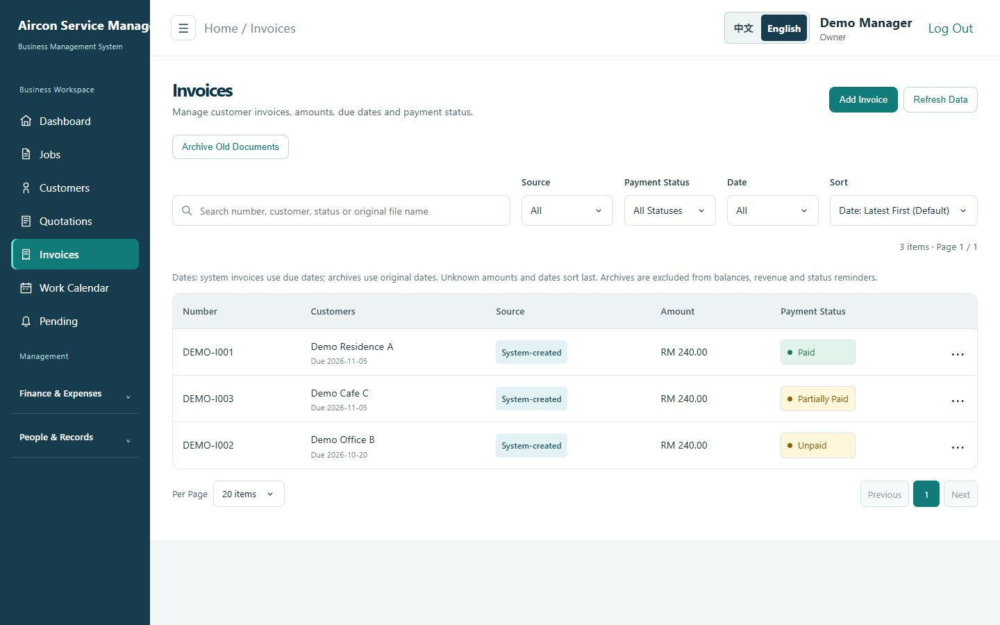
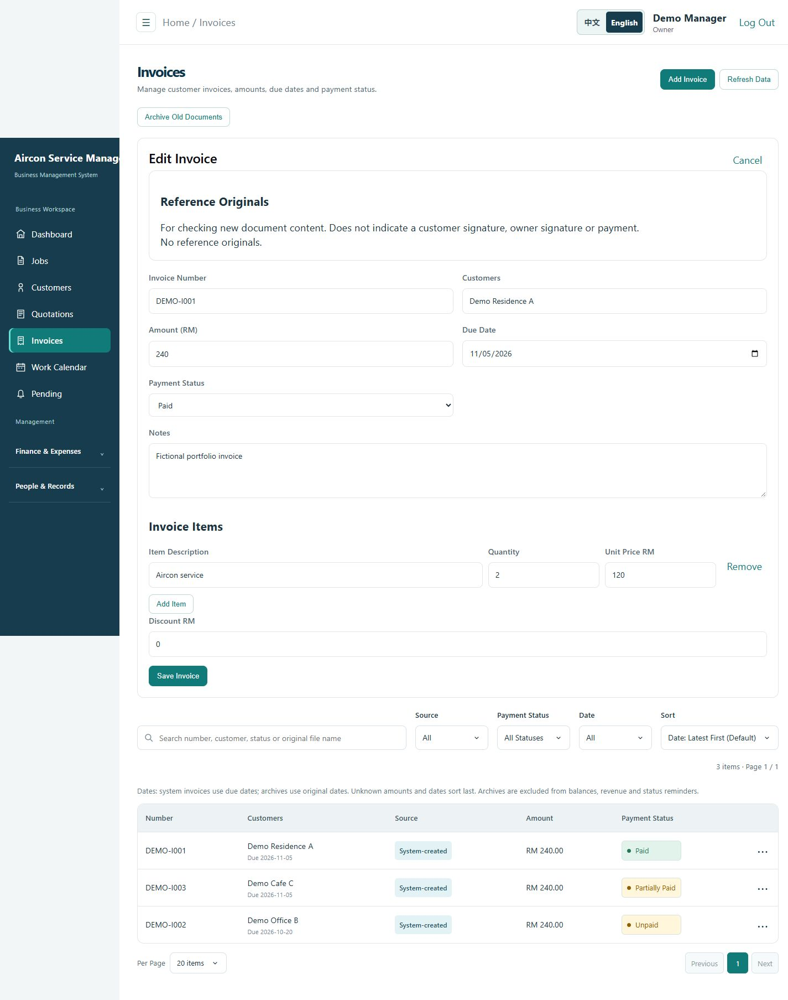
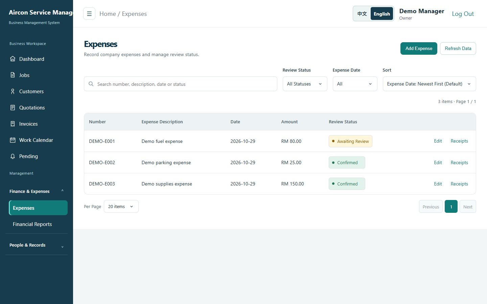
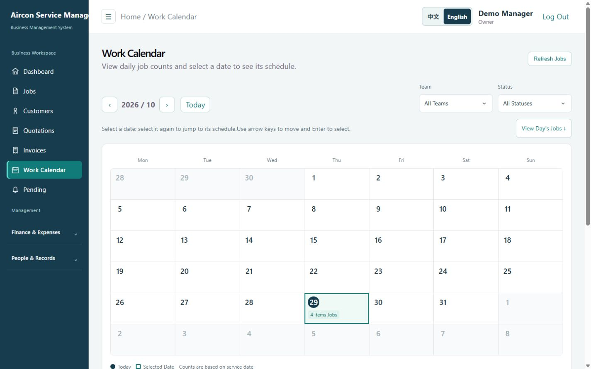
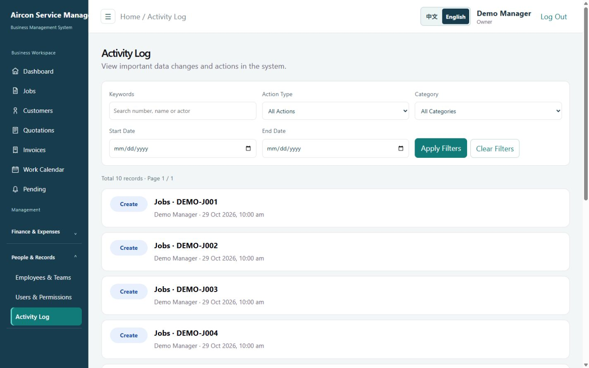

# Aircon Service Management (Demo)

**Full-Stack Web Application | React · TypeScript · ASP.NET Core · Supabase**

## Project Overview

This project is a portfolio demonstration of an internal air-conditioning service management system. The demo configuration uses fictional business information.

The system aims to replace fragmented manual workflows with a centralized platform for managing customers, service jobs, quotations, invoices, scheduling, expenses, and team assignments.

This is a real-world business project designed around operational requirements and day-to-day administrative workflows.

**Project Status:** Functional internal MVP — under active development and improvement.

## Key Features

**Customer Management**
- Create, view, and manage customer information.
- Access customer details and related business records.

**Job Management & Scheduling**
- Create and track air-conditioning service jobs.
- View scheduled work through a calendar interface.
- Assign jobs to teams and manage work arrangements.

**Quotations & Invoices**
- Create and manage quotations and invoices.
- Generate printable PDF documents.
- Import quotation and invoice items from reference PDFs.
- Manage archived quotation and invoice documents.

**Financial & Expense Tracking**
- Record business income and expenses.
- Manage employee expense claims.
- Access financial reporting interfaces.

**Administration & Activity Tracking**
- Dashboard for daily activities and pending tasks.
- Manage team members and assignments.
- Role-based access controls.
- Track system activities through audit logs.

## Technology Stack

| Layer | Technologies |
|---|---|
| Frontend | React, TypeScript, Vite |
| Backend | C#, ASP.NET Core 10 Web API |
| Database | Supabase PostgreSQL |
| Data Integration | Supabase REST API, HttpClient |
| File Storage | Supabase Storage |
| Authentication | ASP.NET Core Cookie Authentication |
| PDF Processing | Playwright, PDF.js |
| Version Control | Git, GitHub |

## System Architecture

The application follows a frontend/backend separation:

```text
React / TypeScript browser UI
          | /api requests + session cookie
          v
ASP.NET Core controllers and authorization policies
          | injected repository and storage interfaces
          v
HttpClient -> Supabase REST API / Auth / Storage
                         |
                         v
                  PostgreSQL records
```

In development, Vite proxies API requests to ASP.NET Core. The backend uses repository implementations and typed HttpClient registrations to access Supabase REST endpoints, rather than Entity Framework Core. Service-role credentials remain on the server.

- **Frontend:** React-based user interface for daily business operations.
- **Backend:** ASP.NET Core Web API for processing requests and business operations.
- **Data Access:** Repository interfaces with Supabase-backed implementations using HTTP requests.
- **Database:** PostgreSQL hosted on Supabase.
- **File Storage:** Supabase Storage for business-related documents.

## Engineering Highlights

- Applied Dependency Injection to separate service dependencies and repository implementations.
- Used typed HttpClient registrations for Supabase integrations.
- Implemented authentication and role-based authorization policies.
- Developed PDF document generation and reference-document import workflows.
- Organized database schema changes through SQL migration files.
- Added automated tests for selected backend and frontend functionality.

## Project Structure

- `frontend/` — React and TypeScript application
- `backend/` — ASP.NET Core Web API and backend tests
- `supabase/` — Database migrations and configuration
- `docs/` — Project documentation
- `deploy/` — Deployment-related resources

## Screenshots

These screenshots show the actual frontend with the demo brand and fictional records supplied by a local, read-only mock API. No database was connected during capture. They illustrate the user interface, not end-to-end backend integration validation.

Screenshots use a 1440-pixel-wide desktop viewport, normally 900 pixels high. The quotation detail uses a taller viewport and the invoice editor uses a full-page capture to show their contents. Text in the images has not been digitally replaced.

### Dashboard

The dashboard provides an overview of daily service jobs, pending quotations, outstanding invoices, expenses requiring review, and business performance.



### Job Management

The Job Management module allows users to create, track, and manage service jobs, including scheduling, team assignments, and job status updates.

It also provides search, filtering, and sorting capabilities to help users manage daily service operations.




### Quotation Details

Review quotation line items, totals and acceptance status, then create a related invoice or service job. The detail view also supports customer-returned PDF attachments.



### Customers Management

Search customer records and filter by customer type or creation date. Customer profiles connect contact information with related service work.



### Quotations List

Track quotation totals and confirmation status, with search, date filters and a distinction between system-created documents and historical archives.



### Invoices List

Review invoice amounts, due dates and payment status across customer accounts.



### Invoice Details / Edit View

The invoice edit view contains customer, due date, payment status, notes and line-item fields. This screenshot shows an existing fictional invoice; no changes were saved during capture.



### Expenses / Reimbursements

Track expense amounts and review status, with receipt management available for each record.



### Calendar / Scheduling

Browse monthly service-job counts and filter the schedule by team or status. Selecting a date reveals its daily jobs.



### Activity Logs

Inspect recorded actions by keyword, action type, category and date range to trace changes to business records.



## Installation / Local Setup

Prerequisites: .NET SDK 10 and a Node.js version compatible with the Vite version in `frontend/package.json` (see the checked-in lockfile for exact dependencies).

1. Install the frontend dependencies with `npm ci` from `frontend/`, and restore the backend with `dotnet restore backend/ShengHengAircon.Api.csproj` from the repository root.
2. Configure a dedicated demo Supabase project through .NET User Secrets for the backend project, or server-side environment variables:

   ```text
   Supabase__Enabled=true
   Supabase__Url=https://your-demo-project.supabase.co
   Supabase__ServiceRoleKey=<server-side-demo-secret>
   ```

   Never put the service-role key in frontend code or a `VITE_` variable. Supabase integration is disabled in the checked-in defaults; data-backed pages require a configured database.
3. Prepare the demo database using the SQL migrations under `supabase/`. Review the migrations before applying them to an isolated database. Configure demo authentication and application roles following [Authentication](docs/authentication.md).
4. Start the API from the repository root:

   ```powershell
   dotnet run --project backend/ShengHengAircon.Api.csproj
   ```

5. In a second terminal, start the frontend:

   ```powershell
   cd frontend
   npm run dev
   ```

Open the Vite URL printed in the terminal (normally `http://localhost:5173`). Vite proxies `/api` requests to `http://localhost:5187`. The API exposes `/api/health` and, in Development, `/openapi/v1.json`.

For PDF generation prerequisites, see [Printing](docs/printing.md). Use a fictional `CompanyProfile` for demo documents, including contact information, registration details and signatures.

Validation commands:

```powershell
# From the repository root
 dotnet test --solution backend/ShengHengAircon.slnx --configuration Release
# From frontend/
 npm run build
 npm run lint
```

## Demo Environment

The screenshots use synthetic local fixtures and do not require Supabase access. The application itself uses the ASP.NET Core backend and requires a separately configured, isolated Supabase demo project for data-backed workflows. Mock screenshots do not demonstrate database persistence or validate the complete PDF and authentication workflows. No hosted demo or credentials are included in this repository.

Use only fictional business information in demonstrations. Keep production databases and credentials separate from local development and portfolio testing.

## Security & Configuration

Keep sensitive credentials outside version control.

Local development uses .NET User Secrets for backend configuration. Deployment requires secure environment configuration.

Real customer data and production credentials are not intended for public demonstration.

## Project Status

The project has reached an initial functional MVP and continues to evolve based on business requirements.

Current priorities include improving usability, validating business workflows, expanding testing, and preparing a secure deployment environment.

The current implementation includes team and employee management and user permissions. The screenshot session had no demo team records, so an empty team screen is omitted. Dedicated warranty-management and settings/integrations pages are not currently implemented.

## About This Project

This project demonstrates practical full-stack development experience, including requirements analysis, API development, database integration, business workflow implementation, debugging, and iterative feature delivery.
